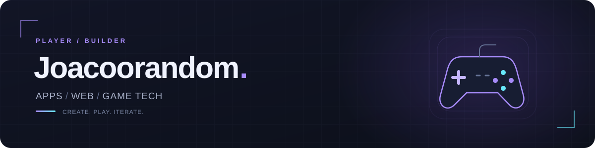

  

### Qué tal, soy Joaco 👋

Creo apps y herramientas web, trabajo en proyectos alrededor de **PixelPlay** y colaboro en **open source**. Me interesan los videojuegos por dentro: desde sus herramientas hasta la traducción de instrucciones CPU/GPU.

  <a href="https://pixelplay.gg">PixelPlay ↗</a>
  &nbsp;·&nbsp;
  <a href="https://github.com/Joacoorandom?tab=repositories">Mis repositorios ↗</a>
  &nbsp;·&nbsp;
  <a href="https://github.com/pulls?q=is%3Apr+author%3AJoacoorandom+is%3Amerged">Contribuciones integradas ↗</a>

## Proyectos para explorar

<!-- PUBLIC_REPOS:START -->

### Proyectos propios

<table>
<tr><th>Proyecto</th><th>Qué hay detrás</th><th>Lenguaje</th></tr>
<tr><td><a href="https://github.com/Joacoorandom/personal-web-"><strong>personal-web-</strong></a></td><td>Mi espacio en la web: desarrollo, streams y comunidad.</td><td>CSS</td></tr>
<tr><td><a href="https://github.com/Joacoorandom/praktico"><strong>praktico</strong></a></td><td>Catálogo web con filtros, carrito y pedidos. Next.js · React · TypeScript.</td><td>TypeScript</td></tr>
</table>

### Forks para explorar

<table>
<tr><th>Proyecto</th><th>Qué hay detrás</th><th>Lenguaje</th></tr>
<tr><td><a href="https://github.com/Joacoorandom/AnyPS5"><strong>AnyPS5</strong></a></td><td>Herramientas para portar ejecutables de PS5 a Linux y Windows.</td><td>C++</td></tr>
<tr><td><a href="https://github.com/Joacoorandom/pixelplay-amethyst"><strong>pixelplay-amethyst</strong></a></td><td>Launcher de Minecraft Java para Android, basado en Amethyst.</td><td>C</td></tr>
<tr><td><a href="https://github.com/Joacoorandom/Xbox2Windows"><strong>Xbox2Windows</strong></a></td><td>Investigación de recompilación estática y traducción CPU/GPU.</td><td>Python</td></tr>
</table>

Catálogo actualizado automáticamente cada 6 horas con datos públicos de GitHub.

<!-- PUBLIC_REPOS:END -->

### En comunidad

- **[Pixel Play Launcher](https://github.com/Pixel-Play-Server/pixelplay-wails)** — Perfiles, mods y amigos en una app de escritorio. Go · Wails · React · TypeScript.
- **[Xbox2Windows](https://github.com/R0Y00/Xbox2Windows)** · contribuidor — Investigación de traducción CPU/GPU y recompilación estática.

## Lo que estoy explorando

- **Apps y web:** interfaces que conviertan una idea en algo que pueda usar.
- **Game tech:** herramientas para videojuegos, shaders y recompilación estática.
- **Open source:** cambios concretos, pruebas reproducibles y mejoras que se puedan revisar.

## Herramientas que uso

  <code>TypeScript</code> <code>React</code> <code>Next.js</code>
  <code>SwiftUI</code> <code>Python</code> <code>C++</code>
  <code>Go</code> <code>Wails</code> <code>Git</code> <code>GitHub Actions</code>

---

Entre código, videojuegos y la próxima idea. 🎮

